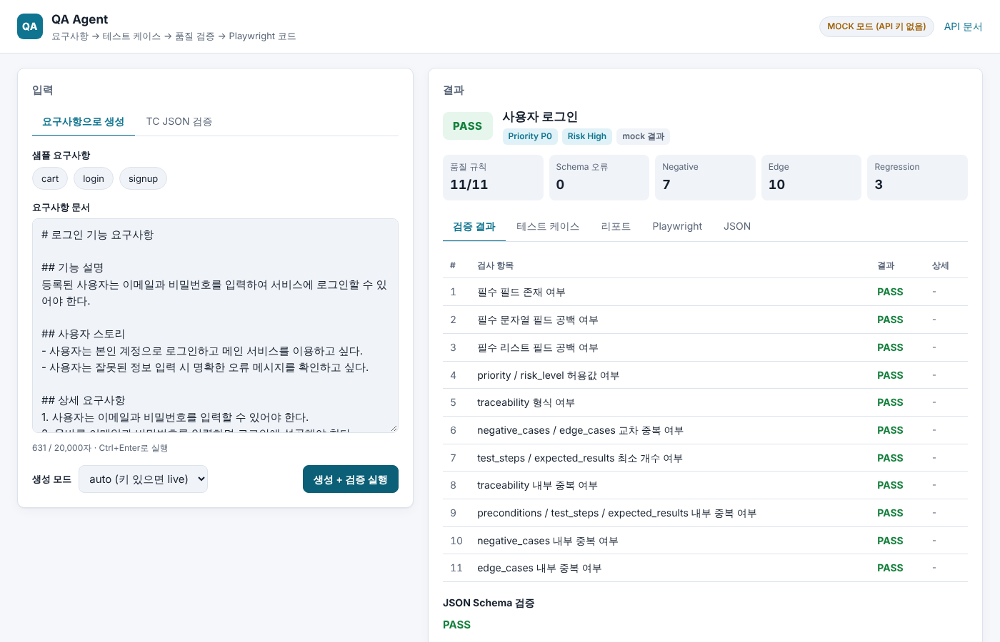
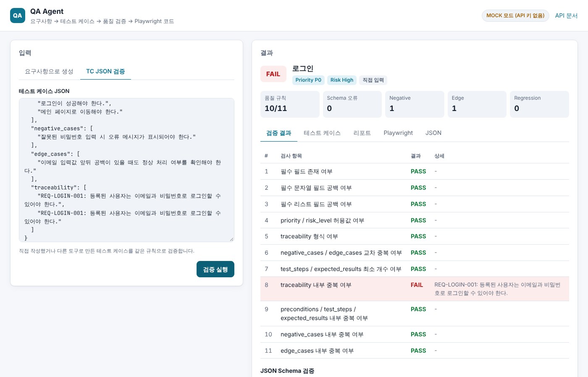
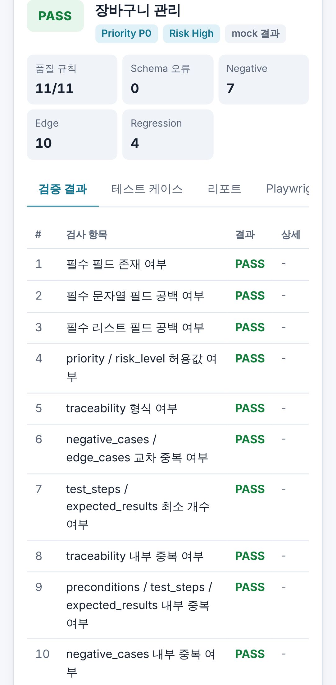
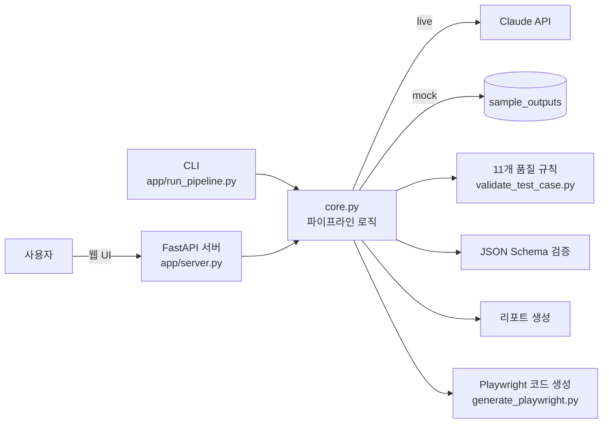

# QA Agent

> 요구사항 문서를 넣으면 **테스트 케이스 생성 → 11개 품질 규칙 + JSON Schema 검증 → 리포트 → Playwright 코드**까지 한 번에 만들어 주는 QA 자동화 도구.
> AI가 만든 테스트 케이스를 그대로 믿지 않고, **QA 관점의 규칙으로 검증**하는 것이 핵심입니다.



| 품질 규칙 위반 감지 (FAIL) | 모바일 |
|---|---|
|  |  |

---

## 1. 왜 만들었나

- 요구사항 분석과 테스트 케이스 작성은 시간이 많이 들고, 사람마다 품질 편차가 큽니다.
- LLM으로 테스트 케이스를 만드는 건 이제 누구나 할 수 있습니다. 차별점은 **"그 테스트 케이스가 좋은지 어떻게 아느냐"** 입니다.
- 이 프로젝트는 생성보다 **검증**에 무게를 둡니다. 필수 항목 누락, 중복, 추적성 형식 오류 같은 문제를 11개 규칙과 JSON Schema로 잡아냅니다.
- 실무에서 겪은 문제(릴리즈 때 커밋 누락으로 기존 기능이 깨지는 회귀)를 프롬프트에 녹여, 생성 결과에 **[Regression] 테스트 포인트가 자동으로 포함**되게 했습니다.

---

## 2. 주요 기능

| 기능 | 설명 |
|------|------|
| 테스트 케이스 생성 | Claude API로 요구사항 → 구조화된 TC JSON (Happy / Negative / Edge / Regression) |
| 품질 검증 11개 규칙 | 필수 필드, 공백, 허용값, 추적성 형식, 최소 개수, 각종 중복 검사 |
| JSON Schema 검증 | `schemas/test_case.schema.json` 기준 구조 검증 (Draft 7) |
| 리포트 | 검증 결과를 markdown 리포트로 생성 |
| Playwright 코드 | TC JSON → Playwright TypeScript 테스트 골격 |
| 웹 UI | 요구사항 입력 또는 TC JSON 붙여넣기 → 결과 탭 / 복사 / 다운로드 |
| mock 모드 | API 키 없이 샘플 결과로 동작 → 데모와 CI가 외부 의존 없이 실행 |

---

## 3. 아키텍처



- **core.py 하나에 로직을 모으고** CLI와 웹 서버가 같은 코드를 씁니다. 같은 규칙이 여러 파일에 복사돼 있으면 한쪽만 고쳐지는 문제가 생기기 때문입니다 (실제로 Day 25에 이런 버그를 발견해 고쳤습니다).
- 웹 UI는 외부 라이브러리 없는 HTML/CSS/JS 세 파일입니다. 서버와 AI가 준 문자열은 모두 `textContent`로만 넣어서 **XSS를 원천 차단**합니다.

---

## 4. 테스트 전략

이 도구 자체도 테스트 대상입니다. 테스트 피라미드에 맞춰 3단계로 나눴습니다.

| 단계 | 도구 | 개수 | 무엇을 보나 |
|------|------|------|------------|
| 단위 | pytest | 29 | 11개 규칙이 정상/불량 샘플을 정확히 판정하는지, mock/live 분기, 생성 코드 이스케이프 |
| API | pytest + FastAPI TestClient | 23 | 엔드포인트별 정상 응답과 오류 코드 (400 / 422 / 502), 정적 파일 경로 탈출 차단 |
| E2E | Playwright (데스크톱 + 모바일) | 25 × 2 | 실제 브라우저 사용자 흐름, 장애 상황, XSS, 키보드 접근성 |

E2E에서 신경 쓴 점:
- **Page Object 패턴**: 화면 요소는 `tests/e2e/pages/QaAgentPage.ts`에만 정의하고, 테스트는 시나리오만 서술합니다. UI가 바뀌어도 한 곳만 고치면 됩니다.
- **`data-testid` 기반 선택자**: CSS 클래스나 문구가 바뀌어도 테스트가 깨지지 않습니다.
- **네트워크 모킹 (`page.route`)**: 502, 500, 422, 연결 실패, 느린 응답처럼 실제로 만들기 어려운 상황을 재현합니다.
- **Flaky 점검**: 전체 스위트를 3회 반복 실행(`--repeat-each=3`)해 150/150 통과를 확인했습니다.
- **보안 / 접근성**: HTML 주입이 실행되지 않는지, 탭을 화살표 키로 이동할 수 있는지, 입력란에 접근 가능한 이름이 있는지 확인합니다.

자세한 내용: [docs/test_strategy.md](docs/test_strategy.md)

---

## 5. 실행 방법

### 설치
```bash
pip install -r requirements.txt
npm ci                                  # E2E 테스트용
npx playwright install chromium         # E2E 테스트용

cp .env.example .env                    # live 모드를 쓸 때만 ANTHROPIC_API_KEY 입력
```

### 웹 UI
```bash
python app/server.py
# → http://127.0.0.1:8000        웹 UI
# → http://127.0.0.1:8000/docs   API 문서 (Swagger)
```

### Docker
```bash
docker build -t qa-agent .
docker run -p 8000:8000 qa-agent                                  # mock 모드
docker run -p 8000:8000 -e ANTHROPIC_API_KEY=sk-... qa-agent      # live 모드
```

### CLI
```bash
# end-to-end 파이프라인
python app/run_pipeline.py sample_inputs/login_requirement.md              # auto: 키 있으면 live, 없으면 mock
python app/run_pipeline.py sample_inputs/login_requirement.md --mode mock

# 단계별 실행
python app/generate_test_case.py sample_inputs/login_requirement.md
python app/validate_test_case.py sample_outputs/login_test_case.json
python app/schema_validate_test_case.py sample_outputs/login_test_case.json
python app/generate_report.py sample_outputs/login_test_case.json
python app/generate_playwright.py sample_outputs/login_test_case.json
```

### 테스트
```bash
python -m pytest tests/test_core.py tests/test_server.py -v              # 단위 + API
npx playwright test --project=ui-desktop --project=ui-mobile              # 웹 UI E2E (서버 자동 실행)
npx playwright show-report                                                # E2E 리포트 보기

python -m pytest tests/test_api_login.py -v                               # 외부 API (dummyjson)
npx playwright test --project=generated                                   # 생성된 테스트 (the-internet.herokuapp.com)
```

---

## 6. API

| Method | Endpoint | 설명 |
|--------|----------|------|
| GET | `/api/health` | 서버 상태, 기본 mode, 모델 |
| GET | `/api/samples` | 샘플 요구사항 목록 |
| POST | `/api/pipeline` | 요구사항 → 생성 + 검증 + 리포트 + Playwright |
| POST | `/api/analyze` | TC JSON → 검증 + 리포트 + Playwright |
| POST | `/api/generate` | 요구사항 → TC JSON |
| POST | `/api/validate` | TC JSON → 11개 규칙 + Schema 검증 |
| POST | `/api/report` | TC JSON → markdown 리포트 |
| POST | `/api/playwright` | TC JSON → Playwright 코드 |

- `mode`: `auto`(기본, API 키 있으면 live / 없으면 mock), `mock`, `live`
- 오류 응답: 입력값 오류 422, live 모드인데 키 없음 400, Claude 응답 실패 502

### 품질 검증 11개 규칙
| 번호 | 검사 항목 |
|------|----------|
| 1 | 필수 필드 존재 여부 |
| 2 | 필수 문자열 필드 공백 여부 |
| 3 | 필수 리스트 필드 공백 여부 |
| 4 | priority / risk_level 허용값 여부 |
| 5 | traceability 형식 여부 (`REQ-기능-001: 설명`) |
| 6 | negative_cases / edge_cases 교차 중복 여부 |
| 7 | test_steps / expected_results 최소 개수 여부 |
| 8 | traceability 내부 중복 여부 |
| 9 | preconditions / test_steps / expected_results 내부 중복 여부 |
| 10 | negative_cases 내부 중복 여부 |
| 11 | edge_cases 내부 중복 여부 |

---

## 7. 폴더 구조

```
qa-agent-mvp/
├── app/
│   ├── core.py                      # 파이프라인 핵심 로직 (CLI / 서버 공용)
│   ├── server.py                    # FastAPI 웹 서버
│   ├── static/                      # 웹 UI (index.html, app.js, style.css)
│   ├── run_pipeline.py              # end-to-end CLI
│   ├── generate_test_case.py        # TC 생성 CLI
│   ├── validate_test_case.py        # 11개 품질 규칙
│   ├── schema_validate_test_case.py # JSON Schema 검증 CLI
│   ├── generate_report.py           # 리포트 생성 CLI
│   ├── generate_playwright.py       # Playwright 코드 생성
│   └── main.py                      # 프롬프트 조립 (Day 1~)
├── tests/
│   ├── test_core.py                 # 단위 테스트
│   ├── test_server.py               # API 테스트
│   ├── test_api_login.py            # 외부 API 테스트 (dummyjson)
│   └── e2e/                         # 웹 UI E2E (Playwright, Page Object)
├── playwright/                      # 파이프라인이 생성한 테스트
├── prompts/                         # 프롬프트 템플릿 (Knowledge Injection 포함)
├── schemas/                         # JSON Schema
├── sample_inputs/ sample_outputs/ sample_reports/
├── docs/                            # 테스트 전략, 일별 작업 기록
├── playwright.config.ts
├── Dockerfile
└── .github/workflows/test.yml       # CI: 단위+API / E2E / 외부 API
```

---

## 8. 기술 스택

| 구분 | 기술 |
|------|------|
| AI | Claude API (Anthropic SDK) |
| 백엔드 | Python, FastAPI, Pydantic |
| 프론트엔드 | HTML, CSS, JavaScript (라이브러리 없음) |
| 테스트 | pytest, FastAPI TestClient, Playwright (TypeScript) |
| 검증 | jsonschema (Draft7Validator) |
| CI / 배포 | GitHub Actions, Docker |

---

## 9. 로드맵

| 단계 | 목표 | 상태 |
|------|------|------|
| 1. 보여주기 | 웹 UI + API + mock 모드 | ✅ 완료 (Day 25~26) |
| 2. 스스로 검증하기 | 이 도구 자체를 단위 / API / E2E로 테스트하고 CI 연동 | ✅ 완료 (Day 26) |
| 3. 팀 워크플로에 붙이기 | PR에서 요구사항 문서가 바뀌면 TC 생성 + 검증 결과를 PR 코멘트로 남기는 GitHub Action | 예정 |
| 4. 품질 측정하기 | 데모 앱에 결함을 일부러 심고, AI 생성 테스트의 결함 검출률을 측정 | 예정 |

---

## 10. 작업 이력

| Day | 작업 내용 |
|-----|----------|
| Day 1~12 | 프롬프트 파이프라인 구성, 테스트 케이스 JSON 설계, validator 구현 |
| Day 13 | negative/edge_cases 내부 중복 검사 추가 |
| Day 14 | JSON Schema 정식 검증 도입 |
| Day 15 | Claude API 연동 테스트 케이스 자동 생성 |
| Day 16 | end-to-end 파이프라인 구현 |
| Day 17 | 검증 결과 markdown 리포트 자동 생성 |
| Day 18 | Playwright 테스트 코드 자동 생성 및 실제 구현 |
| Day 19 | README 포트폴리오용 업데이트 |
| Day 20 | 최종 데모 완성 (end-to-end pipeline PASS) |
| Day 21 | login / signup / cart Playwright Negative Case 구현 |
| Day 22 | API 테스트 자동화 (pytest + requests) |
| Day 23 | GitHub Actions CI 구축 |
| Day 24 | Knowledge Injection Layer: Regression 포인트 자동 포함 |
| Day 25 | 파이프라인 로직 core.py 분리, FastAPI 웹 API + mock 모드, 중복 검사 미수행 버그 수정 |
| Day 26 | 웹 UI, Playwright E2E(Page Object, 데스크톱+모바일), CI 3단 분리, Docker |
