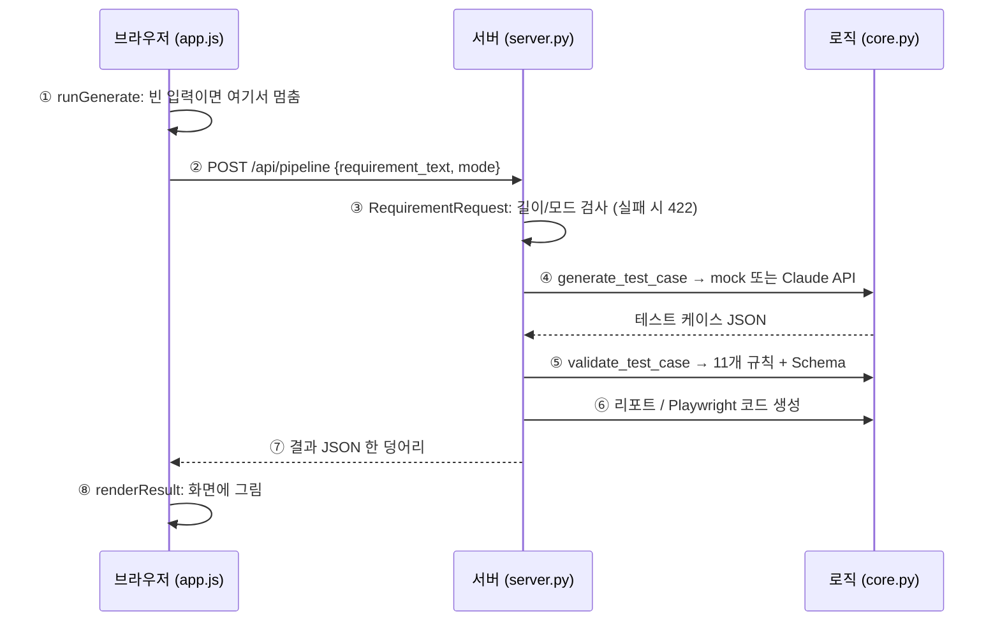

# 해체 1단계: 버튼 하나 누르면 무슨 일이 일어나나

"생성 + 검증 실행" 버튼을 누른 순간부터 화면에 PASS가 뜨기까지를 따라간다.

## 전체 그림



핵심 구조: **브라우저(보여주기) ↔ 서버(받고 돌려주기) ↔ core(실제 일)**. 세 층이 각자 한 가지 일만 한다.

## 단계별

### ① 버튼 클릭 → `runGenerate` (app/static/app.js:186)
```js
const text = $("requirement-input").value;
if (!text.trim()) { showError("요구사항을 입력하세요."); return; }
run("/api/pipeline", { requirement_text: text, mode: $("mode-select").value });
```
- 빈 입력은 **서버에 보내기 전에** 브라우저에서 막는다 → 불필요한 요청과 대기 시간이 없다.
- 하지만 브라우저 검사는 우회할 수 있으니(개발자 도구, curl) **서버도 똑같이 검사한다** (③).
- 이걸 확인하는 E2E: `pipeline.spec.ts` "빈 요구사항은 요청을 보내지 않고 안내한다" (요청이 안 나갔는지까지 확인)

### ② 서버로 요청 → `run` / `api` (app.js:170, :62)
- `setBusy(true)`: 로딩 표시 + 버튼 잠금 → **중복 클릭 방지**
- `fetch`로 POST 요청, 120초 넘으면 중단 (`AbortController`)
- 실패하면 `catch`에서 오류 메시지를 보여주고, **이전 결과는 그대로 둔다**
- `finally`에서 무조건 `setBusy(false)` → 성공이든 실패든 버튼이 다시 풀린다

### ③ 서버 입구 검사 → `RequirementRequest` (app/server.py:31)
```python
requirement_text: str = Field(..., min_length=1, max_length=20000)
mode: Literal["auto", "mock", "live"] = "auto"
```
- 함수 코드가 실행되기 **전에** FastAPI(Pydantic)가 자동으로 검사한다.
- 조건에 안 맞으면 422를 돌려준다. 내가 if문을 쓸 필요가 없다.
- 공백만 있는 입력은 `min_length`로 못 막아서 `_generate`(server.py:40)에서 한 번 더 검사한다.

### ④ 테스트 케이스 생성 → `core.generate_test_case` (app/core.py:169)
```python
used_mode = resolve_mode(mode)      # auto → 키 있으면 live, 없으면 mock
if used_mode == "mock": return generate_mock_test_case(...)
return generate_live_test_case(...) # Claude API 호출
```
- mock: 요구사항에서 "장바구니/회원가입/로그인" 키워드를 찾아 `sample_outputs`의 샘플을 돌려준다 (core.py:127)
- live: 프롬프트 템플릿에 요구사항을 끼워 Claude에 보내고, 응답에서 JSON만 뽑는다
- 실패 종류별로 다른 오류 코드 (server.py:40~50):

| 상황 | 코드 | 의미 |
|------|------|------|
| live인데 API 키 없음 | 400 | 사용자가 잘못 요청함 |
| Claude 응답이 JSON이 아님 / 잘림 | 502 | 뒤쪽(외부 서비스)이 이상함 |
| Claude API 오류 | 502 | 〃 |

### ⑤ 검증 → `core.validate_test_case` (app/core.py:202)
- `run_custom_validation`: `VALIDATION_RULES`(core.py:54) 목록의 11개 규칙을 차례로 실행
  - 각 규칙은 "문제 목록"을 돌려준다. 빈 목록이면 PASS.
- `run_schema_validation`: JSON Schema로 구조 검사
- 둘 다 통과해야 `overall_pass: true`

### ⑥ 리포트 / Playwright 코드 (`_analyze`, server.py:53)
- 검증 결과로 markdown 리포트를 만들고, 테스트 케이스로 Playwright 코드를 만든다.
- 생성, 검증, 리포트, 코드를 **한 번의 응답에 모두 담는다** → 브라우저는 요청 1번으로 탭 5개를 다 채운다.

### ⑦~⑧ 응답 → `renderResult` (app.js:321)
- 요약(PASS/FAIL, 지표) → 검증 표 → 테스트 케이스 → 리포트 / 코드 / JSON 순서로 화면을 채운다.
- 모든 글자는 `textContent`로만 넣는다 → AI나 사용자가 `<script>`를 넣어도 실행되지 않는다 (XSS 방지).

## 면접에서 나올 질문
1. **"왜 브라우저와 서버에서 입력을 두 번 검사하나요?"**
   → 브라우저 검사는 사용자 편의용(빠른 피드백), 서버 검사는 보안/정확성용. 브라우저 검사는 우회할 수 있다.
2. **"400과 502는 왜 나눴나요?"**
   → 누구 잘못인지 구분하기 위해. 4xx는 요청한 쪽 문제, 5xx는 서버 또는 그 뒤 서비스 문제. 모니터링이나 재시도 판단이 달라진다.
3. **"mock 모드는 왜 만들었나요?"**
   → API 키와 비용 없이 데모와 CI 테스트를 돌리기 위해. 테스트 결과가 외부 서비스 상태에 흔들리지 않는다.

## 직접 해보기
1. 서버를 띄우고(`python app/server.py`) 브라우저 개발자 도구(F12) → Network 탭을 연 채로 실행 버튼을 눌러 보기. `pipeline` 요청의 Payload와 Response가 위 ②, ⑦과 같은지 확인.
2. http://127.0.0.1:8000/docs 에서 `/api/pipeline`에 `{"requirement_text": ""}`를 보내 보기. 몇 번 코드가 오는지 **먼저 예상하고** 확인.
3. `{"requirement_text": "결제 기능", "mode": "mock"}`를 보내면 어떤 샘플이 나올까? 예상 → 확인 → 이상하면 backlog.md에 메모.
4. (도전) `mode`에 `"fast"`를 보내면? 어느 단계(①~⑧)에서 막히는지 맞혀 보기.
